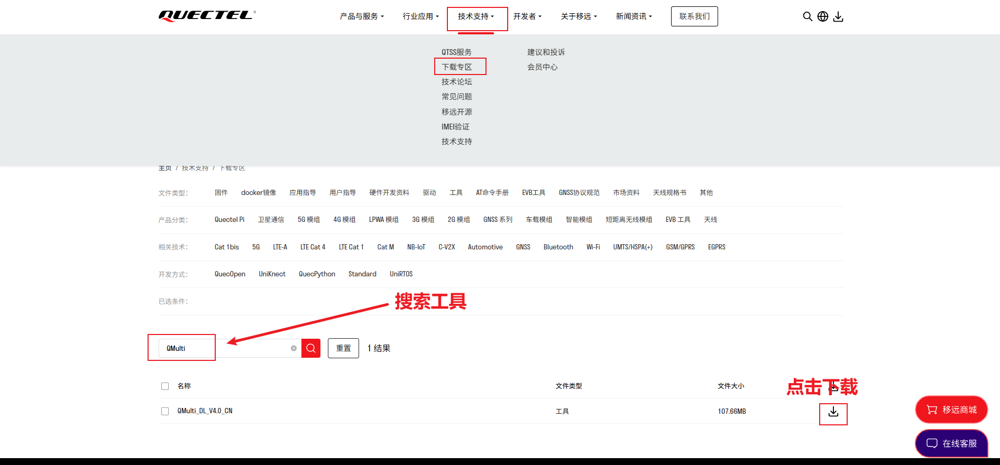

# QMulti_DL 使用教程

## 简介
[QMulti_DL](https://developer.quectel.com/wp-content/uploads/2024/09/QMulti_DL_V3.5_CN.zip) 是用于量产的批量烧录工具

## 工具获取

[官网下载](https://www.quectel.com.cn/download-zone)

## 用户指导

使用说明文档参见工具中pdf文档

注: 若固件后缀格式不符合该工具，则需要使用QPYcom `提取量产包` 功能提取量产包

