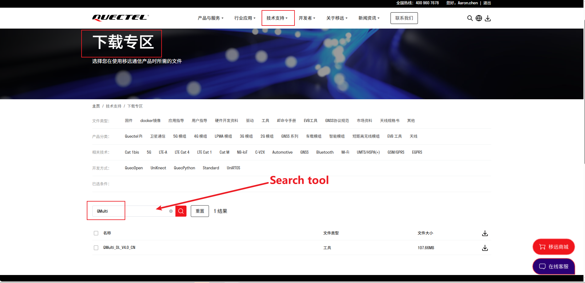

# QMulti_DL Usage Tutorial

## Overview
[QMulti_DL](https://developer.quectel.com/en/wp-content/uploads/sites/2/2024/11/QMulti_DL_V3.5_EN.zip) is a batch burning tool for mass production.

## Obtain the Tool

[Download](https://developer.quectel.com/en/resource-download?cid=261)

## User Guide

For instructions, please refer to the pdf document in the toolkit.

Note: If the firmware suffix format does not conform to the tool, you need to use QPYcom to `Extract MP Firmware` function to extract the MP Firmware.

