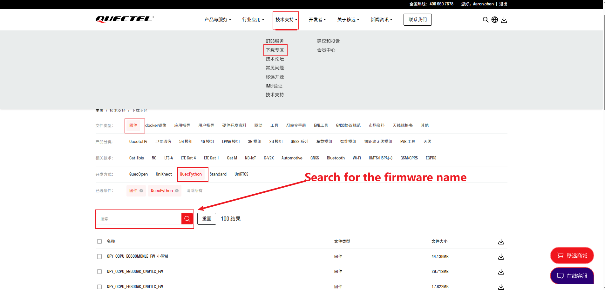

## Flash Firmware

### Get Firmware

Standard AT firmware or QuecOpen firmware is usually downloaded into a module when the module leaves the factory. If you want to develop the module based on QuecPython, you need to manually re-download the dedicated QuecPython firmware into it.

The official firmware download URL is https://www.quectel.com.cn/download-zone.

When faced with a wide variety of firmware options on the official website, how to choose the appropriate firmware package? First, you need to know the model of the module you are using. You can obtain the module model by checking the module's engraving or by sending AT commands.

Once you have obtained the module model, you can download the firmware corresponding to that module on the official website based on the module's model.

The firmware name is generally in the format `QPY_OCPU_<module_model>_FW`, for example `QPY_OCPU_EC800M_CNGC_FW`. If you are using an EC800M_CNGC module, you can download this firmware. You can also select the desired firmware version in the "Version" column. The version number format is unified as `V` + a four-digit version number, for example `V0001`.

Click the download button in the download column to start downloading. After a successful download, you will get a compressed package (zip file) named after the firmware.

> After downloading the firmware zip file to your PC, you need to unzip it. After unzipping, you can get two files. The .bin, .lod or .pac file is the QuecPython firmware, and the .md file is the update logs.

> **For firmware released after May 20, 2024, all module models have been unified to the `.bin` extension.**

| Firmware file extension | Corresponding module model | Remarks |
| ----------------------- | -------------------------- | ------- |
| zip, bin                | EC600M, EC600N, EG915N, EC200N, EG810M | Obtained after unzipping the firmware package |
| pac                     | EC600U, EC200U, EG912U, EC800G, EC600G | Obtained after unzipping the firmware package |
| lod                     | BC25                       | Obtained after unzipping the firmware package |
| binpkg                  | EC600E, EC800E             | After unzipping, select the `at_command.binpkg` file in the folder |
| hbinpkg                 | EC800Z                     | After unzipping, select the `at_command.hbinpkg` file in the folder |
| blf                     | EC200A                     | After unzipping, select the `.blf` file in the folder |
| mbn                     | BG95                       | After unzipping, select the `update\firehose\partition.mbn` file in the firmware folder |

>  Please be sure to unzip the file to a path that does **not contain any Chinese characters, spaces or special characters**. Otherwise, the download tool may not correctly recognize the firmware. Also, the path of the download tool **cannot contain any Chinese characters, spaces and special characters.**

### Flash Firmware

- **Step 1: Create a Project**

First, ensure that the module is properly connected and powered on. Open the QPYcom tool and navigate to the download page. Click on "Create" to create a new firmware project for downloading.

- **Step 2: Select Firmware**

Choose the firmware you want to download to the module (select the firmware corresponding to the module model you are downloading for. If it is a new-format firmware, all module models can simply select the `.bin` file).

For BG95, select the firmware package from the official website, and extract the file with an "mbn" extension. For M/N series, choose the firmware package from the official website and extract the "bin" file. For U/G series modules, select the extracted PAC file. For BC25, select the "lod" file. For A series, choose the "blf" file. For E series, select the "binpkg" file.

- **Step 3: Set Download Mode**

Click on the drop-down arrow next to **"Download script"** and select **"Download FW"**.

- **Step 4: Flash Firmware**

Click on **"Download FW"** to initiate the firmware download. The download process will display a progress bar and percentage. Wait for the download to complete, and you will receive a popup notification indicating a successful download.

| Module model | Notes |
| ------------ | ----- |
| BC25   | You need to open the firmware download serial port first, then click **"Download FW"**. Clicking directly will prompt you to open the serial port. |
| EC200A | After clicking **"Download FW"**, a prompt **"Please restart the board and press RESET"** will appear. Press the **"RESET"** button once to start downloading the firmware. |
| EC600E | Short-circuit the BOOT and GND pins on the development board and press the **"RESET"** button to bring up the download port, then immediately click **"Download FW"** to start downloading the firmware. |
| EC800E | Short-circuit the BOOT and GND pins on the development board and press the **"RESET"** button to bring up the download port, then immediately click **"Download FW"** to start downloading the firmware. |
| EC800Z | Short-circuit the BOOT and EXT pins on the development board and press the **"RESET"** button to bring up the download port. The duration is short, so quickly click **"Download FW"** to start downloading the firmware. |
| EG800Z | Short-circuit the BOOT and EXT pins on the development board and press the **"RESET"** button to bring up the download port. The duration is short, so quickly click **"Download FW"** to start downloading the firmware. |

